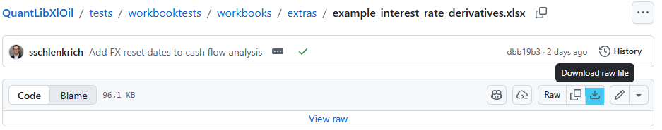
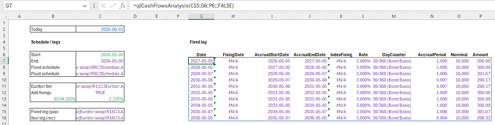
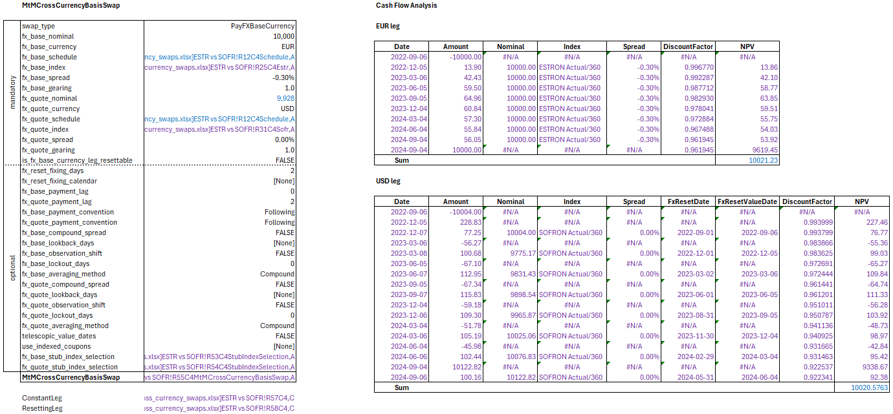
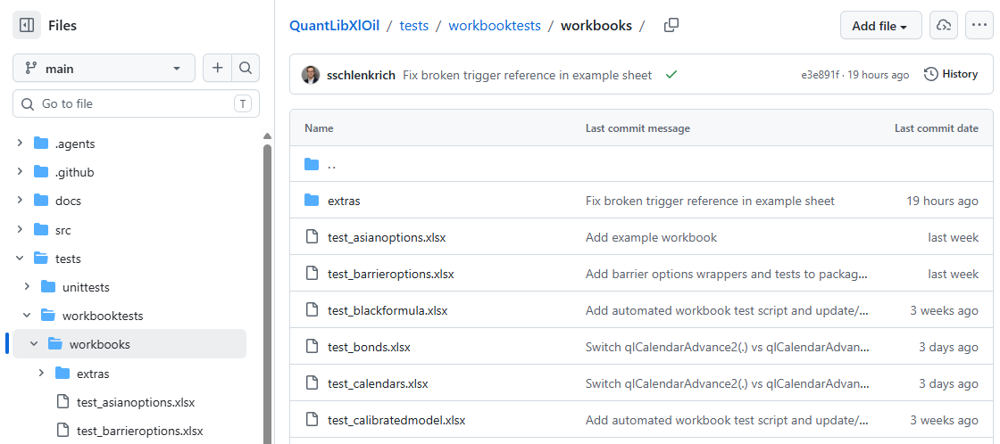

# Example Sheets

This section lists example sheets which are setup as part of the package testing framework.

## How to get the spread sheets?

You can download the sheets by following the links in below subsections and using the *Download raw file* icon.

## Interest Rate Derivatives

An illustrative example of QuantLib in Excel is provided via the [interest rate derivatives sheet](https://github.com/frame-consulting/QuantLibXlOil/blob/main/tests/workbooktests/workbooks/extras/example_interest_rate_derivatives.xlsx).

Follow the [link](https://github.com/frame-consulting/QuantLibXlOil/blob/main/tests/workbooktests/workbooks/extras/example_interest_rate_derivatives.xlsx) and use [*Download raw file*](#how-to-get-the-spread-sheets) icon to download the file.

## Mark-to-Market Cross Currency Swap

Mark-to-market cross currency swap instruments where added to QuantLib v1.44. The [cross currncy swap example sheet](https://github.com/frame-consulting/QuantLibXlOil/blob/main/tests/workbooktests/workbooks/extras/example_cross_currency_swaps.xlsx) demonstrates how to calibrate cross currency basis curves, setup mark-to-market cross currency swaps and analyse cash flows.

Follow the [link](https://github.com/frame-consulting/QuantLibXlOil/blob/main/tests/workbooktests/workbooks/extras/example_cross_currency_swaps.xlsx) and use [*Download raw file*](#how-to-get-the-spread-sheets) icon to download the file.

## Workbook Test Sheets

A comprehensive list of examples are specified in the [workbook test sheets](https://github.com/frame-consulting/QuantLibXlOil/tree/main/tests/workbooktests/workbooks) folder.

